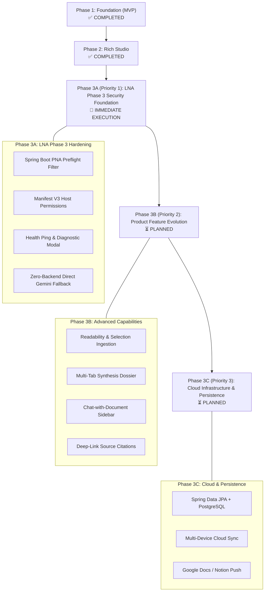
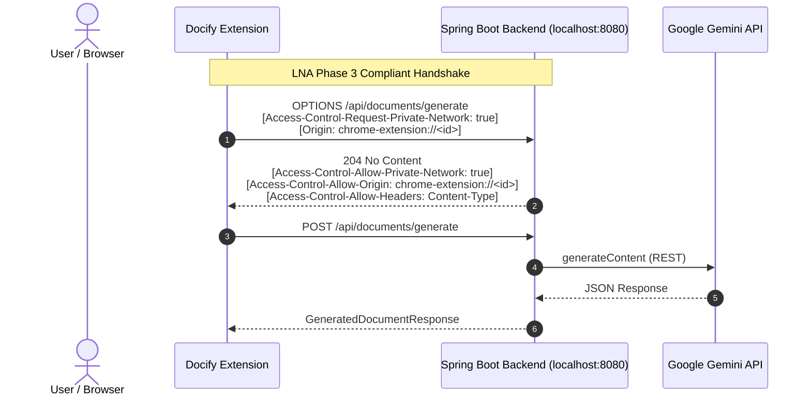

# Docify — Strategic Project Roadmap & Architecture Plans

> **Docify**: *From web to work, instantly.*  
> An AI-powered document generation and editing suite combining a Google Chrome extension (Manifest V3) with a Spring Boot intelligence engine powered by Google Gemini.

---

## 🧭 Phased Execution Strategy

To prevent architectural churn and regressions, development is strictly staged: **Browser Security & LNA Compliance First**, followed by **Product Features**, and finally **Cloud Infrastructure**.

---

## 📌 Phase 1: Foundation & Core Generation (Completed ✅)

Phase 1 established the end-to-end pipeline connecting browser content extraction to AI-generated structured documents.

### Key Deliverables Completed:
- **Chrome Extension Manifest V3 Foundation**: Configured service worker, popup UI, and content script injection.
- **Webpage DOM Content Extractor (`content.ts`)**:
  - Structured extraction of headings (`h1`–`h6`), paragraphs, list items, and table elements.
  - Automatic filtering to ignore boilerplate navigation (`nav`, `header`, `footer`, `aside`).
  - Fallback body text extraction stripping inline scripts and styling.
  - 50,000-character payload sanitization.
- **Spring Boot Intelligence Backend (`docify-backend`)**:
  - `DocumentController.java`: `/api/documents/generate` endpoint.
  - `PromptTemplateService.java`: Schema enforcement requiring strict JSON output (`title`, `summary`, `sections`, `conclusion`, `references`).
  - `OpenAIServiceImpl.java`: Google Gemini 2.5 Flash integration with structured JSON schema mode and OpenAI-compatible API support.
- **Popup Generation Interface (`Popup.tsx`)**:
  - Real-time tab scraping trigger.
  - Document parameter controls: Document Type (*Research Report, Study Notes, Assignment, Business Report, Article, Proposal, Technical Documentation*), Length (*Short, Medium, Long*), and Tone (*Professional, Academic, Casual*).

---

## 📌 Phase 2: Rich Document Studio & Productivity (Completed ✅)

Phase 2 transformed Docify from a simple generator into an interactive document editing suite.

### Key Deliverables Completed:
- **Dedicated TipTap Document Studio (`Editor.tsx` & `editor.html`)**:
  - Full-page editor opening in a separate browser tab.
  - Headless TipTap editor integration with `StarterKit`, `Link`, and `Underline` extensions.
  - Comprehensive formatting toolbar (`EditorToolbar.tsx`) with heading toggles, bold, italic, strike, lists, blockquotes, and dividers.
- **In-Context AI Writing Assistant (`AIAssistant.tsx`)**:
  - TipTap `BubbleMenu` contextual floating prompt on text selection.
  - Quick action transformations: *Rewrite*, *Make Professional*, *Shorten*, *Expand*.
  - Custom instruction input with backend endpoint `/api/documents/ai/rewrite`.
- **Multi-Format Document Export (`pdfExporter.ts`)**:
  - Clean client-side PDF compilation utilizing `html2pdf.js` with document styling.
  - Markdown export (`.md`) via HTML-to-Markdown conversion.
  - Plain text export (`.txt`) preserving hierarchy.
- **Local Document Storage & History (`storage.ts`)**:
  - Automatic background persistence to `chrome.storage.local`.
  - Recent documents list with instant reloading from popup history tab.
  - Auto-save indicators in the editor top bar.

---

## 🎯 Phase 3A (Priority 1): Chrome Local Network Access (LNA) Phase 3 Foundation

Securing browser-to-backend communication against Chrome's LNA Phase 3 restrictions is the immediate prerequisite before adding new features.

### Threat Model & Architecture
Chromium’s **Local Network Access (LNA)** policy blocks public pages and extensions from making requests to local network devices and loopback addresses (`localhost`, `127.0.0.1`) unless the target server responds to CORS preflights with explicit PNA headers.

### Phase 3A Tasks:
1. **Spring Boot PNA Preflight Filter (`LocalNetworkAccessFilter.java`)**:
   - Intercept `OPTIONS` preflight requests containing `Access-Control-Request-Private-Network: true`.
   - Respond with `Access-Control-Allow-Private-Network: true`.
   - Allow origins from `chrome-extension://*` and `http://localhost:*`.
   - Set `Access-Control-Max-Age: 3600` to prevent redundant preflights.
2. **Manifest V3 Permission Hardening (`public/manifest.json`)**:
   - Add explicit host permissions for `http://localhost:8080/*` and `http://127.0.0.1:8080/*`.
   - Specify CSP `connect-src` parameters to avoid extension sandbox blocks.
3. **Backend Health & Diagnostic Handshake (`/api/health`)**:
   - Add lightweight health ping endpoint.
   - Display troubleshooting guidance modal if LNA blocks or server is offline.
4. **Zero-Backend Direct Client Fallback (Serverless Mode)**:
   - Allow users to enter a Gemini API Key in extension settings to call Gemini directly from the browser, bypassing local network calls completely.

---

## 🚀 Phase 3B (Priority 2): Advanced Product Features & Conversational Studio

Once the network and security layer is stabilized, product capabilities will be expanded:

1. **Readability-Based DOM Parsing (`content.ts`)**:
   - Integrate Mozilla’s Readability engine to strip ads, sidebars, and navigation, extracting pristine body text.
2. **Context Menu Ingestion**:
   - Right-click selected web text → "Docify Selection" via Chrome context menus.
3. **Multi-Tab Research Dossier**:
   - Combine text from multiple selected browser tabs into a single comprehensive synthesis.
4. **"Chat with Document" Interactive Sidebar (`Editor.tsx`)**:
   - Collapsible panel allowing conversational queries, fact-checking, and iterative section rewrites.
5. **Deep-Link Source Citations**:
   - Generate URL text fragments (`#:~:text=`) pointing directly to exact source quotes.
6. **Custom Document Templates**:
   - Presets for PRDs, Academic Notes, Executive Briefs, and user-saved schemas.

---

## ☁️ Phase 3C (Priority 3): Cloud Infrastructure, JPA Persistence & Sync

1. **Spring Data JPA & PostgreSQL Persistence**:
   - Activate JPA dependencies in `pom.xml` with entity models for documents, sections, and users.
2. **Multi-Device Cloud Sync**:
   - Sync document drafts and history across browsers via secure REST API.
3. **Cloud Export Integrations**:
   - One-click export to Google Docs (Google Workspace API) and Notion (Notion API).

---

## 📅 Roadmap Schedule & Prioritization Matrix

| Phase | Priority | Focus | Key Deliverables | Status |
| :--- | :--- | :--- | :--- | :--- |
| **Phase 3A** | **P1 (Immediate)** | **LNA Phase 3 Security Foundation** | • Spring Boot `LocalNetworkAccessFilter` • `manifest.json` host permissions & CSP • Health diagnostic ping (`/api/health`) & UI • Direct Gemini API fallback mode | **COMPLETED ✅** |
| **Phase 3B** | **P2 (Next)** | **Product Features & Studio** | • Readability parser in content script • Selection context menu • Multi-tab aggregation • Chat-with-document sidebar • Deep-link citation anchors | **NEXT 🚀** |
| **Phase 3C** | **P3 (Subsequent)** | **Cloud Infrastructure & Sync** | • PostgreSQL/JPA schema & repositories • Cloud sync REST API • Google Docs & Notion integrations | **PLANNED ⏳** |
